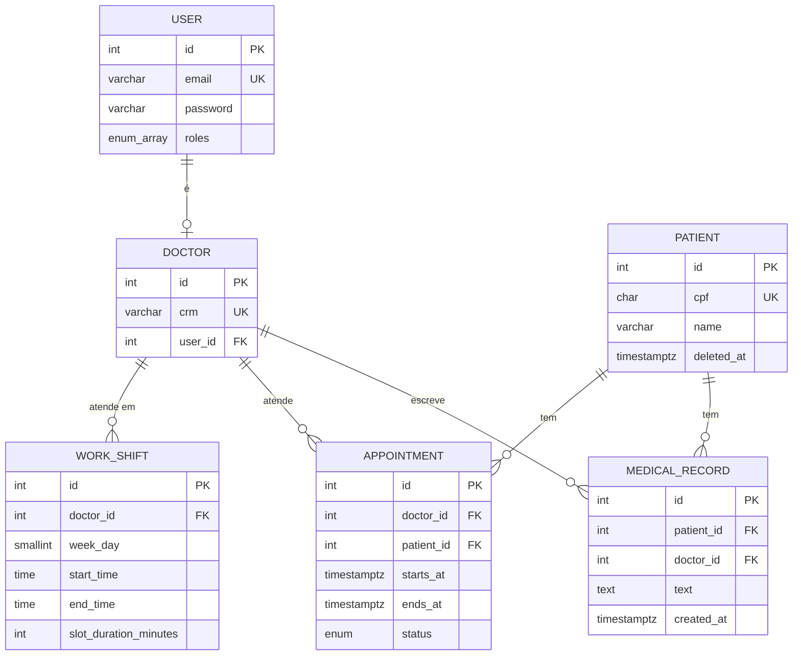

# MedClinic API

API REST de uma clínica médica, feita com NestJS, TypeORM e PostgreSQL. Ela cuida de:

- **usuários e perfis** (administração, secretaria e médico);
- **pacientes** e **médicos**;
- a **escala de trabalho** do médico: os turnos em que ele atende (dia da semana, horário e duração de cada consulta);
- o **agendamento de consultas**: marcar a consulta de um paciente com um médico, com validação do horário e proteção contra conflito (dois pedidos para o mesmo horário);
- a **agenda do médico**: a visão de um período, com os turnos em que ele atende e as consultas já marcadas para ele;
- o **prontuário**: os registros de texto do atendimento, com acesso por vínculo (só o médico que atendeu o paciente escreve).

|                                      |                                                                                                |
| ------------------------------------ | ---------------------------------------------------------------------------------------------- |
| **API publicada (produção)** | https://medclinic-api-nest.onrender.com (rotas sob `/api/v1`; teste: `GET /api/v1/health`) |
| **Repositório**               | https://github.com/wal-projeto/medclinic-api-nest                                              |
| **Board do projeto**           | [Board de gestão: MedClinic API, Etapa 2](https://github.com/users/wal-projeto/projects/4)     |

> Se o serviço publicado estiver parado por inatividade, a primeira resposta demora mais que as seguintes. O banco da API publicada é um PostgreSQL gerenciado no Neon, e as migrations rodam sozinhas quando a API sobe.

## Sumário

1. [Escopo](#escopo)
2. [Ambientes](#ambientes)
3. [Tecnologias](#tecnologias)
4. [Pré-requisitos](#pré-requisitos)
5. [Como rodar localmente](#como-rodar-localmente)
6. [Variáveis de ambiente](#variáveis-de-ambiente)
7. [Comandos](#comandos)
8. [Arquitetura](#arquitetura)
9. [Estrutura de pastas](#estrutura-de-pastas)
10. [Padrão de nomes](#padrão-de-nomes)
11. [Modelagem de dados e decisões](#modelagem-de-dados-e-decisões)
12. [Resumo dos endpoints](#resumo-dos-endpoints)
13. [Respostas padronizadas](#respostas-padronizadas)
14. [Testes e cobertura](#testes-e-cobertura)
15. [CI/CD: integração contínua e entrega contínua (ou publicação contínua)](#cicd-integração-contínua-e-entrega-contínua-ou-publicação-contínua)
16. [Fluxo de trabalho no Git](#fluxo-de-trabalho-no-git)

## Escopo

- **Autenticação e usuários:** login com JWT; três perfis (`admin`, `secretary`, `doctor`); um usuário pode ter mais de um perfil. O primeiro administrador é criado por uma migration, com e-mail e senha lidos do ambiente.
- **Pacientes:** cadastro com CPF único, busca por nome, alteração e remoção lógica. O paciente não é usuário do sistema.
- **Médicos:** cadastro do médico e do usuário dele na mesma transação, com CRM único.
- **Escala de trabalho:** turnos por dia da semana, cada um com a duração da consulta; a escala é substituída por inteiro a cada envio.
- **Agenda do médico:** a visão de um período de até 31 dias, com a escala do médico (os turnos em que ele atende) e as consultas marcadas para ele, da mais cedo para a mais tarde, sem as canceladas.
- **Agendamento de consultas:** o horário precisa cair num turno, estar alinhado à grade do turno e caber nele; o médico e o paciente não podem ter duas consultas ao mesmo tempo, nem com dois pedidos simultâneos; listagem com filtros e consulta por número.
- **Ciclo de vida da consulta:** `scheduled`, `in_progress`, `done` e `cancelled`, com as trocas permitidas e quem pode fazer cada uma. Consulta cancelada libera o horário.
- **Prontuário:** só o médico que atendeu o paciente escreve; o `admin` e o médico com vínculo leem. Os registros só são criados, nunca alterados.
- **Transversal:** listagens paginadas, erro sempre no mesmo formato, validação de entrada e variáveis de ambiente validadas ao subir.

## Ambientes

O projeto roda em dois ambientes, o de **desenvolvimento** (a sua máquina) e o de **produção** (a API publicada na nuvem):

|                        | Desenvolvimento                                                           | Produção                                      |
| ---------------------- | ------------------------------------------------------------------------- | ----------------------------------------------- |
| Onde roda              | na sua máquina                                                           | no Render                                       |
| Como a API sobe        | `npm run start:dev`                                                     | a imagem Docker construída pelo `Dockerfile` |
| Banco de dados         | PostgreSQL num contêiner Docker (`docker-compose.yml`, porta `5433`) | PostgreSQL gerenciado no Neon                   |
| Variáveis de ambiente | o arquivo `.env`                                                        | as variáveis do Render                         |
| Endereço              | `http://localhost:3000`                                                 | `https://medclinic-api-nest.onrender.com`     |
| `DB_SSL`             | `false`                                                                 | `true`                                        |
| Migrations             | aplicadas ao subir, no banco local                                        | aplicadas ao subir, no banco do Neon            |

## Tecnologias

| Tecnologia                          | Para quê                                                                                                   |
| ----------------------------------- | ----------------------------------------------------------------------------------------------------------- |
| Node.js 22                          | ambiente de execução                                                                                      |
| NestJS 12                           | framework da API (módulos, injeção de dependência, guards, pipes e filtros)                             |
| TypeScript 6, com `strict`        | tipagem estrita, sem `any` explícito                                                                     |
| TypeORM 1.x                         | acesso ao banco e migrations                                                                                |
| PostgreSQL                          | banco de dados: a versão 18 num container no ambiente local (`postgres:18-alpine`)                       |
| Neon                                | PostgreSQL gerenciado onde roda o banco da API publicada                                                    |
| class-validator e class-transformer | validação dos corpos, das consultas e das variáveis de ambiente                                          |
| argon2                              | hash das senhas                                                                                             |
| jsonwebtoken                        | assinatura e verificação do JWT                                                                           |
| Vitest 5 (com SWC)                  | testes unitários e cobertura (provedor v8)                                                                 |
| oxlint e Prettier                   | análise estática (com checagem de tipos) e formatação                                                   |
| Docker e Docker Compose             | o Compose sobe o PostgreSQL local do desenvolvimento; o Docker empacota a API numa imagem para a produção |
| GitHub Actions                      | CI/CD: validação dos pull requests e publicação em produção                                                  |
| GitHub Container Registry e Render  | imagem publicada e hospedagem da API                                                                        |

## Pré-requisitos

- Node.js 22 e npm
- Docker, com o Docker Compose
- Git

## Como rodar localmente

Passo a passo do ambiente de **desenvolvimento**, na sua máquina:

```text
git clone https://github.com/wal-projeto/medclinic-api-nest.git
cd medclinic-api-nest
npm ci
cp .env.example .env     # abra o .env e preencha (veja os valores abaixo)
docker compose up -d     # sobe o PostgreSQL local: container "pg", porta 5433
npm run start:dev        # a API sobe em http://localhost:3000 e aplica as migrations
```

O `docker compose up -d` cria o **banco do ambiente de desenvolvimento** num contêiner Docker, então não é preciso instalar o PostgreSQL na máquina. É nesse banco que a API roda e é testada localmente. Os dados ficam guardados no volume `pgdata` e continuam lá depois de desligar o contêiner.

Valores do `.env` para o banco do `docker-compose.yml`:

```env
PORT=3000
LOG_LEVEL=log
DB_HOST=localhost
DB_PORT=5433
DB_USER=admin
DB_PASSWORD=postgres
DB_NAME=medclinic-api
DB_SSL=false
DB_LOG_LEVEL=error
ADMIN_EMAIL=admin@clinica.com
ADMIN_PASSWORD=escolha-uma-senha-com-8-ou-mais-caracteres
JWT_SECRET=cole-aqui-um-segredo-com-32-ou-mais-caracteres
JWT_EXPIRES_IN=8h
```

Para gerar um `JWT_SECRET` válido (o segredo que assina os tokens precisa ser longo e imprevisível), rode no terminal:

```bash
openssl rand -hex 32
```

O que o comando faz: o `openssl` é uma ferramenta de criptografia que já vem no Linux, no macOS e no Git Bash do Windows; o `rand` pede bytes aleatórios; o `-hex` mostra esses bytes em hexadecimal (os caracteres `0` a `9` e `a` a `f`); e o `32` é a quantidade de bytes. Cada byte vira 2 caracteres, então a saída tem **64 caracteres**, mais que os 32 que a API exige. O resultado é diferente a cada vez, por exemplo `9f2ad04c...`. Copie a linha inteira e cole no `.env`, depois de `JWT_SECRET=`.

Sem o `openssl`, o Node gera o mesmo tipo de valor:

```bash
node -e "console.log(require('crypto').randomBytes(32).toString('hex'))"
```

Use um segredo diferente em cada ambiente (o local e o publicado), e nunca o escreva no repositório.

Conferindo que subiu (este teste é feito pelo terminal, com o `curl`, mas também pode ser feito no Postman, com a mesma URL, o mesmo método e o mesmo corpo):

```text
curl http://localhost:3000/api/v1/health
# {"status":"ok"}

curl -X POST http://localhost:3000/api/v1/auth/login \
  -H "Content-Type: application/json" \
  -d '{"email":"admin@clinica.com","password":"<o valor de ADMIN_PASSWORD>"}'
# {"accessToken":"..."}
```

No Postman: o `/health` é uma requisição `GET` para `http://localhost:3000/api/v1/health`; o login é uma requisição `POST` para `http://localhost:3000/api/v1/auth/login`, com **Body**, **raw**, **JSON** e o mesmo corpo do `curl`.

Nas demais rotas, o token vai no cabeçalho `Authorization: Bearer <accessToken>` (no Postman, na aba **Authorization**, escolha **Bearer Token** e cole o `accessToken`). Com o token do administrador dá para criar os outros perfis:

```bash
curl -X POST http://localhost:3000/api/v1/users \
  -H "Authorization: Bearer <accessToken>" -H "Content-Type: application/json" \
  -d '{"name":"Joana Secretária","email":"joana@clinica.com","password":"SenhaForte@123","roles":["secretary"]}'
```

O médico se cadastra em `POST /api/v1/doctors` (cria o médico e o usuário dele juntos).

## Variáveis de ambiente

O arquivo `.env` **não é versionado**. O `.env.example` lista todas as chaves, sem valores reais. Se uma variável obrigatória faltar ou for inválida, a API **não sobe** e diz qual é o problema.

| Variável          | Papel                            | Regra                                                                                              | Exemplo local                                                                                        |
| ------------------ | -------------------------------- | -------------------------------------------------------------------------------------------------- | ---------------------------------------------------------------------------------------------------- |
| `PORT`           | porta HTTP da API                | número                                                                                            | `3000`                                                                                             |
| `LOG_LEVEL`      | nível de log do Nest            | `verbose`, `debug`, `log`, `warn`, `error` ou `fatal`                                  | `log`                                                                                              |
| `DB_HOST`        | endereço do PostgreSQL          | texto                                                                                              | `localhost`                                                                                        |
| `DB_PORT`        | porta do PostgreSQL              | número (padrão `5432`)                                                                         | `5433` (a do `docker-compose.yml`)                                                               |
| `DB_USER`        | usuário do banco                | texto                                                                                              | `admin`                                                                                            |
| `DB_PASSWORD`    | senha do banco                   | texto                                                                                              | `postgres`                                                                                         |
| `DB_NAME`        | nome do banco                    | texto                                                                                              | `medclinic-api`                                                                                    |
| `DB_SSL`         | liga o SSL na conexão           | `true` ou `false` (padrão `false`)                                                          | `false` (use `true` em banco gerenciado que exige SSL, como o Neon)                              |
| `DB_LOG_LEVEL`   | o que o TypeORM registra no log  | `query`, `schema`, `error`, `warn`, `info`, `log` ou `migration` (padrão `error`) | `error` (use `query` para ver o SQL)                                                             |
| `ADMIN_EMAIL`    | e-mail do primeiro administrador | e-mail válido; a migration `SeedAdmin` o lê                                                    | `admin@clinica.com`                                                                                |
| `ADMIN_PASSWORD` | senha do primeiro administrador  | no mínimo 8 caracteres                                                                            | (escolha uma)                                                                                        |
| `JWT_SECRET`     | segredo que assina os tokens     | no mínimo 32 caracteres                                                                           | gerado com `openssl rand -hex 32` (explicação em [Como rodar localmente](#como-rodar-localmente)) |
| `JWT_EXPIRES_IN` | validade do token                | número e unidade `s`, `m`, `h` ou `d` (padrão `8h`)                                    | `8h`                                                                                               |

Atenção a quatro pontos:

- `JWT_SECRET=troque-este-segredo`, que vem no `.env.example`, **é curto demais** (menos de 32 caracteres) de propósito: a API recusa o valor, e isso obriga a trocar por um segredo de verdade.
- `ADMIN_EMAIL` e `ADMIN_PASSWORD` só são lidos pela migration que cria o primeiro administrador, na primeira vez que a API sobe num banco novo. Se faltarem nesse momento, a migration falha com uma mensagem explicando.
- Na API publicada, `DB_HOST`, `DB_PORT`, `DB_USER`, `DB_PASSWORD` e `DB_NAME` apontam para o banco do Neon, com `DB_SSL=true`. Esses valores ficam nas variáveis de ambiente do Render, nunca no repositório.
- Nenhum valor de ambiente está escrito no código.

## Comandos

| Comando                        | O que faz                                                                                                             |
| ------------------------------ | --------------------------------------------------------------------------------------------------------------------- |
| `npm run start:dev`          | sobe a API em modo de desenvolvimento, recarregando ao salvar                                                         |
| `npm run start`              | sobe a API sem recarregar                                                                                             |
| `npm run build`              | compila o TypeScript para a pasta `dist/`                                                                           |
| `npm run start:prod`         | roda a versão compilada (`node dist/main`); precisa do `build` antes                                             |
| `npm test`                   | roda os testes unitários                                                                                             |
| `npm run test:cov`           | roda os testes com cobertura; falha se ficar abaixo de 80% no recorte (veja [Testes e cobertura](#testes-e-cobertura)) |
| `npm run lint`               | análise estática com o oxlint, incluindo a checagem de tipos                                                        |
| `npm run format`             | formata o código com o Prettier                                                                                      |
| `npm run migration:generate` | compila e gera uma migration nova, comparando as entidades com o banco                                                |

**Migrations.** Todas ficam em `src/@common/database/migrations/`. O `synchronize` do TypeORM fica sempre desligado: o banco só muda por migration.

- Ao subir, a API aplica sozinha as migrations que ainda não rodaram (é assim que o banco da nuvem é criado).
- Para criar uma migration depois de mudar uma entidade (com o banco local ligado e em dia): `npm run migration:generate`. Rode uma vez só, abra o arquivo gerado e formate com `npx prettier --write src/@common/database/migrations/`.
- Para aplicar ou desfazer à mão, depois do `build`:

```text
npm run build
npx typeorm migration:run -d dist/@common/database/cli-typeorm.js
npx typeorm migration:revert -d dist/@common/database/cli-typeorm.js   # desfaz a última
```

**Docker no projeto.** Há dois arquivos Docker, e cada um serve a uma coisa:

| Arquivo                | Para quê                                                                                        | Quando se usa                                                                           |
| ---------------------- | ------------------------------------------------------------------------------------------------ | --------------------------------------------------------------------------------------- |
| `docker-compose.yml` | sobe o **PostgreSQL local**: contêiner `pg`, porta `5433`, dados no volume `pgdata` | no **desenvolvimento**: é o banco em que a API roda e é testada na sua máquina |
| `Dockerfile`         | empacota a **API** numa imagem                                                             | em **produção**: a esteira constrói essa imagem e o Render a executa           |

**Banco local (desenvolvimento).** Comandos do `docker-compose.yml`:

```text
docker compose up -d     # liga o PostgreSQL local (contêiner "pg", porta 5433)
docker compose down      # desliga; os dados continuam guardados no volume "pgdata"
docker compose down -v   # desliga e APAGA os dados do banco local
```

**Imagem da API (produção).** O `Dockerfile` compila a API num estágio e leva só o necessário para o estágio final. É essa imagem que roda em **produção**, no Render (veja [CI/CD](#cicd-integração-contínua-e-entrega-contínua-ou-publicação-contínua)). Para testar a imagem na sua máquina, com o banco local ligado:

```bash
docker build -t medclinic-api .
docker run --rm -p 3000:3000 --add-host=host.docker.internal:host-gateway \
  --env-file .env -e DB_HOST=host.docker.internal -e DB_PORT=5433 medclinic-api
```

Dentro do contêiner da API, o banco do Compose não está em `localhost`, por isso o `DB_HOST` e a `DB_PORT` são trocados no `docker run`.

## Arquitetura

A API é dividida em camadas. Cada uma só conversa com a de baixo, e o banco fica no fim:

```
requisição HTTP
   │
   ├─ JwtGuard            confere o token e o perfil exigido pela rota (@RequireRole)
   ├─ AppValidationPipe   valida o corpo, a query e os parâmetros (DTOs); descarta campos que o DTO não declara
   ▼
Controller                só recebe, entrega ao service e devolve; sem regra de negócio
   ▼
Service                   as regras de negócio e a autorização que depende dos dados
   ▼
Repository (a "porta")    uma classe abstrata que diz o que o service pode pedir ao banco
   ▼
Adaptador TypeORM         cumpre a porta com TypeORM e PostgreSQL
   ▼
PostgreSQL

AppExceptionFilter        recebe qualquer erro e responde no formato { statusCode, error, message }
```

Decisões:

- **Regra de negócio nos services, acesso ao banco nos repositórios.** Nenhum controller contém regra nem importa o TypeORM. Isso deixa a regra testável sem banco.
- **Porta e adaptador.** O service depende de uma classe abstrata (`PatientRepository`), e o módulo liga essa classe ao adaptador (`PatientTypeormRepository`). Nos testes entra um dublê em memória no lugar do adaptador.
- **Um módulo por recurso** (`patient`, `doctor`, `appointment`, `medical-record`, `user`, `auth`). Quando um módulo precisa de outro, ele importa a **porta** que o outro exporta (o prontuário usa a porta das consultas para conferir o vínculo).
- **Guard global.** Toda rota exige token, menos as marcadas com `@PublicRoute()` (`/health` e `/auth/login`). O perfil exigido fica no `@RequireRole([...])` da rota; o que depende dos dados (por exemplo, "o médico só vê as próprias consultas") fica no service.
- **Erros sempre no mesmo formato**, sem detalhe interno (nada de *stack trace*, nome de tabela ou SQL na resposta): um erro inesperado vira `500` com uma mensagem genérica, e o detalhe vai só para o log do servidor.
- **Configuração validada ao subir** (`src/env.ts`): variável faltando ou inválida impede a API de iniciar.

## Estrutura de pastas

```
src/
├── main.ts                     ponto de entrada: prefixo /api/v1 e porta
├── app.module.ts               junta os módulos e registra o guard, o pipe e o filtro globais
├── env.ts                      as variáveis de ambiente e as regras de validação
├── health.controller.ts        GET /health
├── @common/                    o que mais de um módulo usa
│   ├── database/               conexão, lista de entidades, nomes snake_case e migrations/
│   ├── exceptions/             AppException e o catálogo de códigos de erro
│   ├── filters/                AppExceptionFilter (o formato único de erro)
│   ├── pagination/             o DTO de page/pageSize e a função paginate (envelope de listagem)
│   └── pipes/                  AppValidationPipe
├── auth/                       login, JWT, hash de senha, JwtGuard e os decorators (@RequireRole, @PublicRoute, @GetAuthUser)
├── user/                       usuários e perfis
├── patient/                    pacientes
├── doctor/                     médicos e escala de trabalho
├── appointment/                agendamento de consultas, regras de horário, agenda do médico
└── medical-record/             prontuário
```

Dentro de cada módulo:

```
patient/
├── patient.entity.ts               a tabela
├── patient.repository.ts           a porta (classe abstrata)
├── patient-typeorm.repository.ts   o adaptador do TypeORM
├── patient.service.ts              as regras
├── patient.service.spec.ts         os testes do service
├── patient.controller.ts           as rotas
├── patient.module.ts               liga tudo
└── dtos/                           os corpos e as consultas que a rota aceita
```

## Padrão de nomes

| Onde                   | Padrão                                                                                                       | Exemplos                                                                                      |
| ---------------------- | ------------------------------------------------------------------------------------------------------------- | --------------------------------------------------------------------------------------------- |
| Pastas                 | um módulo por recurso, no singular, em minúsculas e com hífen                                              | `patient/`, `medical-record/`, `@common/`                                               |
| Arquivos               | `<nome>.<papel>.ts`, em kebab-case                                                                          | `patient.entity.ts`, `work-schedule.service.ts`, `create-patient.dto.ts`                |
| Porta e adaptador      | `<nome>.repository.ts` e `<nome>-typeorm.repository.ts`                                                   | `appointment.repository.ts`, `appointment-typeorm.repository.ts`                          |
| Testes                 | `<arquivo>.spec.ts`, ao lado do arquivo testado                                                             | `appointment.service.spec.ts`                                                               |
| Classes                | PascalCase, com o papel no nome                                                                               | `PatientService`, `PatientRepository`, `PatientTypeormRepository`, `CreatePatientDto` |
| Funções e variáveis | camelCase                                                                                                     | `resolveEndsAt`, `existsByDoctorAndPatient`                                               |
| Constantes             | UPPER_SNAKE_CASE                                                                                              | `LINK_STATUSES`, `STATUS_TRANSITIONS`, `MAX_INTEGER`                                    |
| Rotas                  | substantivos no plural, em kebab-case, sob `/api/v1`; o recurso filho vem depois do pai                     | `/patients`, `/doctors/{id}/work-schedule`, `/patients/{id}/medical-records`            |
| JSON                   | camelCase                                                                                                     | `startsAt`, `doctorId`, `accessToken`                                                   |
| Códigos de erro       | UPPER_SNAKE_CASE                                                                                              | `HORARIO_INDISPONIVEL`, `TRANSICAO_INVALIDA`                                              |
| Tabelas e colunas      | tabelas no singular e colunas em snake_case (o `SnakeCaseNamingStrategy` converte)                          | `work_shift`, `starts_at`, `doctor_id`                                                  |
| Constraints e índices | prefixo pelo tipo: `pk_`, `fk_`, `uq_`, `ck_`, `idx_`                                               | `fk_appointment_doctor_id`, `uq_patient_cpf`                                              |
| Variáveis de ambiente | UPPER_SNAKE_CASE                                                                                              | `DB_HOST`, `JWT_SECRET`                                                                   |
| Branches               | `<tipo>/<assunto>`                                                                                          | `feat/appointment-status`, `docs/readme`                                                  |
| Commits                | semânticos (`feat:`, `fix:`, `test:`, `ci:`, `docs:`, `chore:`), dizendo o que a alteração faz | `feat: adiciona a rota GET /appointments/{id}`                                              |

## Modelagem de dados e decisões



- **Perfis numa coluna `roles`** (lista de valores do enum `admin`, `secretary`, `doctor`): um usuário pode acumular perfis sem precisar de uma tabela a mais.
- **Paciente à parte do usuário.** O paciente não acessa o sistema, então não tem login. O CPF é `char(11)`, só dígitos, e único. A remoção é **lógica** (`deleted_at`): a linha fica, o histórico de consultas e de prontuário continua íntegro, e o CPF removido segue ocupado.
- **Médico = linha em `doctor` + usuário com perfil `doctor`**, criados na mesma transação; o CRM é único.
- **Escala em turnos** (`work_shift`): dia da semana, início, fim e a duração da consulta daquele turno. O `PUT` substitui a escala inteira, e os turnos do mesmo dia não podem se sobrepor.
- **A consulta guarda o início e o fim** (`starts_at` e `ends_at`, `timestamptz`, em UTC). O fim é calculado na marcação (início mais a duração do turno) e gravado, então mudar a escala depois **não mexe nas consultas já marcadas**. Para decidir se um horário cai num turno, o dia e a hora são lidos no relógio da clínica (`America/Sao_Paulo`).
- **Consulta cancelada não é apagada:** o estado vai para `cancelled` e ela só deixa de ocupar o horário.
- **Duas defesas para a integridade:** a regra no service e as `CHECK`, as chaves estrangeiras e as unicidades no banco (por exemplo `starts_at < ends_at`, texto do prontuário não vazio, `week_day` de 0 a 6). As chaves estrangeiras não têm `CASCADE`.
- **Concorrência.** A marcação roda numa transação que **trava a linha do médico** (`SELECT ... FOR UPDATE`) antes de conferir a sobreposição, então dois pedidos simultâneos para o mesmo horário nunca passam os dois. A troca de estado usa `UPDATE ... WHERE id = ? AND status = <estado lido>`: se outra requisição chegou antes, nada é gravado e a resposta é `422`.
- **Prontuário.** Muitos registros por paciente, cada um com o médico autor (sempre o do token, nunca o do corpo). A tabela só tem `created_at`, sem `updated_at`, e não há rota para editar nem apagar. O **vínculo** do médico com o paciente não é uma coluna: é calculado perguntando à tabela de consultas se existe uma consulta entre os dois em andamento ou concluída. O índice `(patient_id, created_at)` serve à listagem.
- **Chaves e datas.** Chaves `integer` geradas pelo banco (`GENERATED ALWAYS AS IDENTITY`); todas as datas em `timestamptz`, devolvidas em ISO 8601 (UTC).

## Resumo dos endpoints

Todas as rotas ficam sob `/api/v1`. "Autenticado" significa qualquer perfil com um token válido.

| Método | Rota                               | Perfis                                                                                                                                                 |
| ------- | ---------------------------------- | ------------------------------------------------------------------------------------------------------------------------------------------------------ |
| GET     | `/health`                        | público                                                                                                                                               |
| POST    | `/auth/login`                    | público                                                                                                                                               |
| GET     | `/users/me`                      | autenticado                                                                                                                                            |
| POST    | `/users`                         | admin                                                                                                                                                  |
| POST    | `/patients`                      | admin, secretary                                                                                                                                       |
| GET     | `/patients`                      | autenticado (`?name=`, `page`, `pageSize`)                                                                                                       |
| GET     | `/patients/{id}`                 | autenticado                                                                                                                                            |
| PATCH   | `/patients/{id}`                 | admin, secretary                                                                                                                                       |
| DELETE  | `/patients/{id}`                 | admin                                                                                                                                                  |
| POST    | `/doctors`                       | admin                                                                                                                                                  |
| GET     | `/doctors`                       | autenticado (`?name=`, `page`, `pageSize`)                                                                                                       |
| GET     | `/doctors/{id}`                  | autenticado                                                                                                                                            |
| PUT     | `/doctors/{id}/work-schedule`    | admin                                                                                                                                                  |
| GET     | `/doctors/{id}/work-schedule`    | autenticado                                                                                                                                            |
| GET     | `/doctors/{id}/calendar`         | autenticado (`?from=` e `?to=`, `AAAA-MM-DD`, até 31 dias)                                                                                      |
| POST    | `/appointments`                  | admin, secretary                                                                                                                                       |
| GET     | `/appointments`                  | autenticado, filtrado por perfil: o médico vê só as próprias (`?doctorId=`, `patientId`, `status`, `from`, `to`, `page`, `pageSize`) |
| GET     | `/appointments/{id}`             | autenticado, com posse: o médico só vê a própria                                                                                                   |
| PATCH   | `/appointments/{id}/status`      | conforme a transição (veja abaixo)                                                                                                                   |
| POST    | `/patients/{id}/medical-records` | doctor com vínculo com o paciente                                                                                                                     |
| GET     | `/patients/{id}/medical-records` | admin, ou doctor com vínculo (`page`, `pageSize`)                                                                                                 |

**Troca de estado da consulta** (`PATCH /appointments/{id}/status`, corpo `{ "status": "in_progress" }`):

| De                        | Para            | Quem pode                                 |
| ------------------------- | --------------- | ----------------------------------------- |
| `scheduled`             | `in_progress` | o médico da consulta, ou admin           |
| `scheduled`             | `cancelled`   | admin, secretary ou o médico da consulta |
| `in_progress`           | `done`        | o médico da consulta, ou admin           |
| `in_progress`           | `cancelled`   | admin ou o médico da consulta            |
| `done` ou `cancelled` | qualquer        | ninguém (estados finais)                 |

**Vínculo** entre um médico e um paciente: existe pelo menos uma consulta entre os dois em `in_progress` ou `done`. Consulta agendada ou cancelada não conta.

## Respostas padronizadas

**Erro.** Toda resposta de erro, de 400 a 500, tem o mesmo corpo. E ele **nunca traz detalhe interno**, isto é, nada que mostre como o servidor funciona por dentro: nem o *stack trace* (a lista de arquivos e linhas por onde o erro passou), nem o texto técnico do banco de dados (nome de tabela, de constraint ou o SQL), nem caminhos de arquivo. Quem chama a API recebe só o código do erro e uma mensagem escrita para ela; o detalhe técnico fica apenas no log do servidor. Um erro inesperado, por exemplo, responde `500` com a mensagem genérica "Erro interno do servidor.". Um erro de regra de negócio traz a causa em linguagem simples:

```json
{ "statusCode": 409, "error": "HORARIO_INDISPONIVEL", "message": "O médico já tem uma consulta nesse horário" }
```

| Código                    | Status | Quando                                                                   |
| -------------------------- | ------ | ------------------------------------------------------------------------ |
| `DADOS_INVALIDOS`        | 400    | corpo, consulta ou parâmetro inválido                                  |
| `NAO_AUTENTICADO`        | 401    | token ausente, malformado, inválido ou expirado                         |
| `CREDENCIAIS_INVALIDAS`  | 401    | e-mail ou senha errados no login                                         |
| `ACESSO_NEGADO`          | 403    | o perfil, ou a falta de vínculo ou de posse, não permite a operação  |
| `RECURSO_NAO_ENCONTRADO` | 404    | o recurso não existe                                                    |
| `EMAIL_JA_CADASTRADO`    | 409    | e-mail já usado por outro usuário                                      |
| `CPF_JA_CADASTRADO`      | 409    | CPF já cadastrado (inclusive de paciente removido)                      |
| `CRM_JA_CADASTRADO`      | 409    | CRM já cadastrado                                                       |
| `HORARIO_INDISPONIVEL`   | 409    | o médico já tem consulta que se sobrepõe ao horário                  |
| `PACIENTE_INDISPONIVEL`  | 409    | o paciente já tem consulta que se sobrepõe ao horário                 |
| `HORARIO_FORA_DA_ESCALA` | 422    | o horário não cai num turno, não está na grade ou não cabe no turno |
| `TRANSICAO_INVALIDA`     | 422    | a troca de estado não existe no ciclo de vida da consulta               |

Um erro inesperado responde `500` com `error: "ERRO_INTERNO"` e uma mensagem genérica.

**Listagem.** Toda listagem é paginada e devolve os itens junto dos números da paginação. `?page=` começa em 1 (padrão 1) e `?pageSize=` vai de 1 a 100 (padrão 20); valor inválido responde `400`:

```json
{
  "data": [ { "id": 1, "name": "Maria" } ],
  "meta": { "total": 57, "page": 1, "pageSize": 20, "totalPages": 3 }
}
```

## Testes e cobertura

```text
npm test         # roda os testes
npm run test:cov # roda os testes com cobertura
```

**O recorte da cobertura** é `src/**/*.service.ts` (configurado em `vitest.config.mts`). Entram na conta os 10 arquivos de service:

| Pasta               | Arquivos                                                                              |
| ------------------- | ------------------------------------------------------------------------------------- |
| `appointment/`    | `appointment.service.ts`, `appointment-rules.service.ts`, `calendar.service.ts` |
| `auth/`           | `jwt.service.ts`, `password.service.ts`                                           |
| `doctor/`         | `doctor.service.ts`, `work-schedule.service.ts`                                   |
| `medical-record/` | `medical-record.service.ts`                                                         |
| `patient/`        | `patient.service.ts`                                                                |
| `user/`           | `user.service.ts`                                                                   |

**Por que esse recorte.** Os services são a camada onde moram as regras que quebram: a sobreposição de horários, o alinhamento à grade, o ciclo de vida da consulta, o vínculo do prontuário e a autorização que depende dos dados. Ficam **fora** da conta, de propósito: os controllers (só repassam), as entidades, os módulos e os DTOs (são declarações), as migrations, o `main.ts` e o `env.ts`, e os adaptadores do TypeORM, que só fazem sentido com um banco de verdade. Incluí-los inflaria o número sem testar regra nenhuma.

**Como os testes são feitos.** São testes unitários dos services, com **dublês em memória no lugar dos repositórios** (as portas). Nenhum teste depende de banco, de rede ou de variável de ambiente. Os casos de erro (`403`, `404`, `409`, `422`) têm teste próprio, e não só o caminho feliz.

**Limiar e resultado.** O limiar é de **80%** em linhas, ramos, funções e instruções, e o `npm run test:cov` falha se algum ficar abaixo. Hoje a suíte tem 159 testes em 10 arquivos, com **100%** nos quatro indicadores.

## CI/CD: **integração contínua** e **entrega contínua** (ou **publicação contínua**)

Publicar é colocar a API no ar no ambiente de **produção**. Os dois workflows ficam em `.github/workflows/`:

- **`pr-workflow.yml` (CI, check `validate`)**: roda em todo pull request para a `main`. Faz `npm ci`, `npm run build` e `npm run test:cov` com Node 22. Se o código não compila ou se a cobertura de testes fica abaixo de 80%, o check do pull request, no GitHub, fica vermelho (reprovado); quando tudo passa, ele fica verde.
- **`deploy.yml` (CD)**: roda a cada push na `main` (isto é, a cada merge). Constrói a imagem Docker, publica no GitHub Container Registry (`ghcr.io/<repositório>:<commit>` e `:latest`) e chama o *deploy hook* do Render, que passa a rodar a imagem nova. O endereço do hook fica num *secret* do GitHub; as variáveis de ambiente de produção ficam no Render.

**Ambiente publicado.** A API roda no Render, a partir da imagem do GitHub Container Registry, e se conecta a um PostgreSQL gerenciado no **Neon**, com SSL. Ao subir, ela aplica no banco do Neon as migrations que ainda não rodaram.

## Fluxo de trabalho no Git

1. Cada funcionalidade nasce numa **branch própria**, a partir da `main` (`feat/...`, `fix/...`, `test/...`, `ci/...`, `docs/...`).
2. Commits pequenos, com mensagem semântica.
3. Pull request para a `main`, com título e uma descrição curta do que ele entrega. Cada pull request fecha o card correspondente do board (`Closes #N`).
4. Merge só com o check `validate` verde.
5. O merge dispara a publicação em produção (o CD).

**Gestão do projeto.** O projeto foi gerenciado no **GitHub Projects**, num board **Kanban** público: [board do projeto](https://github.com/users/wal-projeto/projects/4). Cada funcionalidade é um card (uma issue) que descreve o que fazer e como saber que terminou. O card entra em **Backlog**, vai para **Em andamento** quando a branch é criada, para **Em revisão** quando o pull request é aberto com `Closes #N`, e para **Concluído** quando o pull request é mergeado (essas duas últimas trocas são automáticas).
